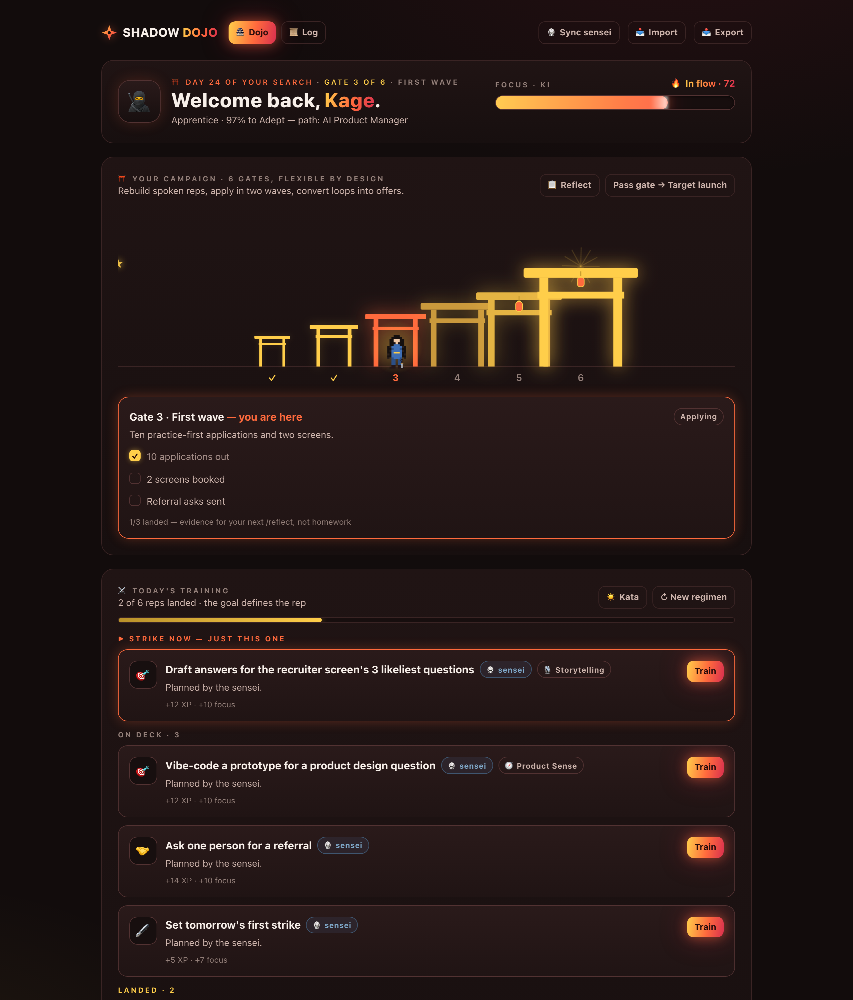
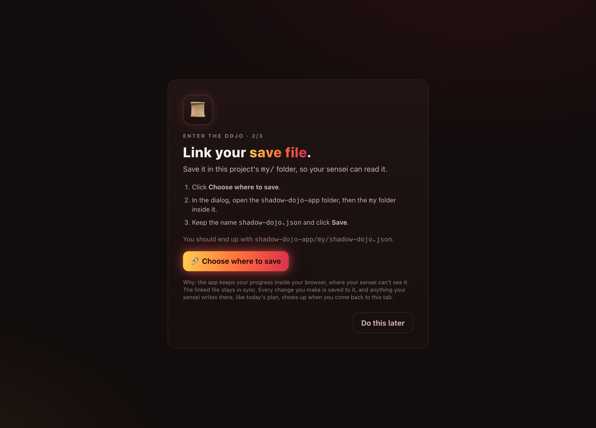
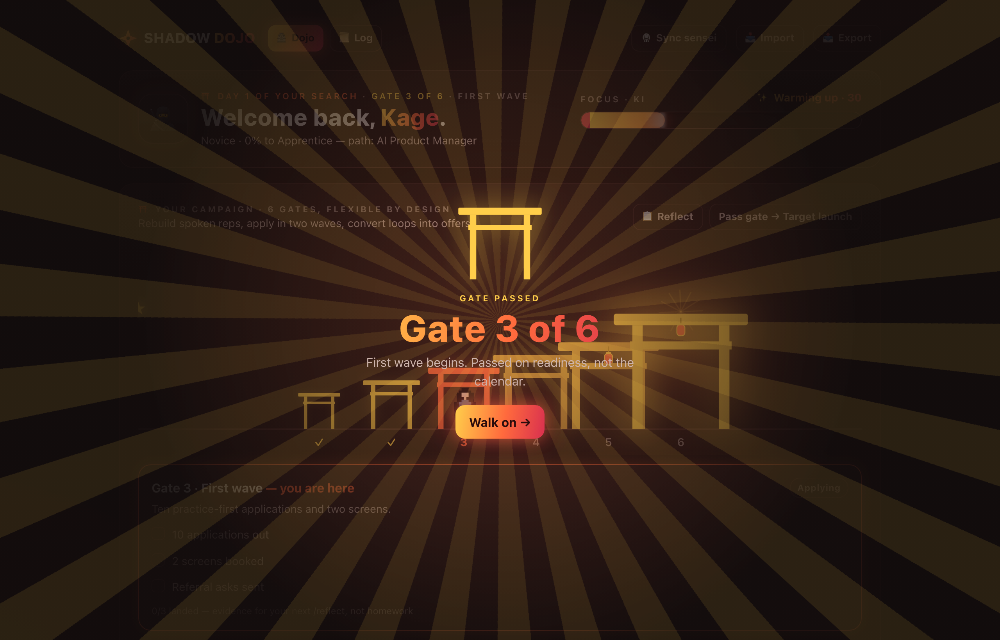
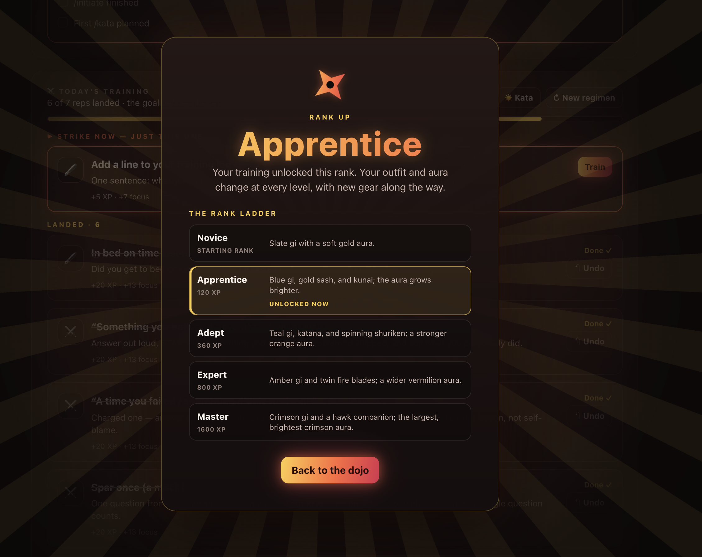

# AI Product Shadow Dojo

I built Shadow Dojo to have fun and stay motivated during my own AI product manager job search. A training game for an AI PM job search with an AI sensei that runs in an AI coding assistant of your choice. This is a public copy of my private repo. 
- **The sensei handles the admin.** It reads your calendar, inbox and follow-ups, then works with you to build each day's training around what's on your plate.
- **Practice levels you up.** Each completed rep earns XP. As you rank up, your ninja's outfit and weapons upgrade.
- **Skills cover the whole search.** Find postings (`/patrol`), judge them (`/scout`), practice answers (`/spar`), plan the day (`/kata`), review the week (`/reflect`).

Mock screenshots below



| Setup links your save file | Passing a gate | Ranking up |
|---|---|---|
|  |  |  |

## How it's organized

- **Training** is general practice. Practice questions, mocks and story work each earn XP for
  one of six skills and fill your **ki** (momentum). The sensei plans it, and the app keeps
  score.
- **Missions** are the pursuit of specific companies: finding roles, judging them, tailoring
  your resume, and getting referrals. They live in Notion.
- **Gates** split your campaign into stretches you pass when you're ready, not when the
  calendar says so. Your sensei builds them from your strategy.
- **The bridge:** once a mission reaches interviews, training turns toward that company.

There are two parts, and they share one file:

```
browser app  ── autosaves ──▶  my/shadow-dojo.json  ◀── reads and edits ──  your AI agent (the sensei)
             ◀─ Sync sensei ─                                                     │
                                                  my/sensei-context.md  ◀── its memory of you
                                                  Notion  ◀── missions: postings, pipeline, dream list
```

The app is React and runs locally in your browser; it has no backend and no AI of its own. The
sensei is any AI coding agent (Claude Code, Codex, Cursor) opened in this folder. It follows
[AGENTS.md](AGENTS.md) and [SENSEI.md](SENSEI.md), and the prompt files in [prompts/](prompts/).

## Skills

| Command | What it does | How it works |
|---|---|---|
| `/initiate` | First session | Checks your setup, interviews you, and builds your campaign's gates from your strategy |
| `/kata` | Plans today | Reads your calendar, inbox and pipeline, asks what today should hold, then writes an ordered day with a tiny first step |
| `/reflect` | Weekly retro | What worked, what didn't, what changes next week, then the gate call: pass, stay, or re-plan |
| `/spar` | Works one answer | As a coach, section by section, or as a realistic interviewer, graded against the [rubrics](rubrics/) created from Product Manager interview courses |
| `/scout` | Judges a role | Checks facts live, reads recent Glassdoor and Blind reviews in your browser, weighs fit, desire and odds, and makes a rep-or-target call. Dream companies go on your dream list |
| `/patrol` | Finds postings | Searches LinkedIn, screens against your dealbreakers, and stages every posting in Notion with a first call. Can run daily in the cloud |
| `/harvest` | Evals for Patrol | Answers your comments on patrol's picks, tunes its filters for Patrol (checking past calls still hold), and moves the keepers into your pipeline |
| `/forge` | Aims your resume | Draft multiple master resumes; Decides whether to send a resume version as is, tweak it, or start a new master; writes a plan for you to approve; and verifies a one-page PDF |
| `/referral` | Finds a warm path | Scans LinkedIn for people you know or near the hiring team, picks the ask, and drafts a note you send yourself |
| `/applied` | Logs an application | Updates the pipeline and your dream-list counters |

Each mission skill sets itself up the first time you run it. Nothing ever sends a message or
submits an application for you.

## Levels and visual upgrades

- **Titles** rise with XP: Novice → Apprentice (120) → Adept (360) → Expert (800) → Master
  (1600).
- **The ninja at your gate changes with each title:**
  - Her outfit recolors slate → blue → teal → amber → crimson.
  - She gains gear: a sash and kunai at Apprentice, a katana and shuriken at Adept, fire blades
    at Expert, a hawk at Master.
  - Her aura grows from a gold glow to a crimson blaze.
- **Six skills** (product sense, AI fluency, metrics, storytelling, behavioral, execution) each
  level up every 60 XP.
- **Ki fills as you train.** Hitting full ki pays a bonus and leaves an afterglow. The first rest
  day is free; after that ki drains quickly, but never below a floor of 12. A title can erode
  after several idle days, by at most half, and one rep restarts the clock.
- **XP pays for exposure, not effort:** a live mock is worth far more than reading an article.
- **Gates grow taller toward the end of your campaign.** Interview-stage gates get a boss look,
  and passing one plays a fanfare.

## Get started

1. **Install** [Node](https://nodejs.org) 20 or later, then run:

   ```bash
   npm install
   ```

   ```bash
   npm run dev
   ```

2. **Set up the app** (three screens): your name, linking the save file, and meeting your sensei.
   Linking needs Chrome or Edge; in other browsers, use Export and Import instead. Save the file
   in this project's `my/` folder.
3. **Turn on connectors in your AI agent:**
   - **Notion:** required for the mission skills.
   - **Google Calendar:** so `/kata` plans around your day. On a Mac, `scripts/cal.sh` works
     without it.
   - **Gmail:** so `/kata` sees recruiter replies and interview invites. Read-only.
   - **Claude in Chrome:** so `/scout` and `/referral` can read pages you're logged into.
4. **Open this folder in your agent and start your first session,** one of two ways:
   - **Claude Code:** type `/initiate`.
   - **Any other agent (Codex, Cursor…):** paste the prompt from the app's third setup screen,
     or just say "Read AGENTS.md, then run prompts/initiate.md with me."

   Then click **Sync sensei** in the app.

Optional tools: [Typst](https://typst.app) for `/forge`, and Bun (or Node's `npx tsx`) for
`/patrol`.

## Day to day

- **Every morning:** `/kata`, then **Sync sensei**. Work the reps top to bottom in the app.
- **As roles come up:** `/scout` them, `/forge` your resume for the ones that matter, and use
  `/referral` before applying cold.
- **Once a week:** `/reflect`.
- **Patrol on a schedule:** on its first run, `/patrol` offers to set up a daily cloud routine
  (in Claude Code, through `/schedule`). The routine needs your GitHub copy of this repo and the
  Notion connector. If LinkedIn blocks the cloud run, it falls back to a local scheduled task.

## Your data

- **Everything about you lives in `my/`,** which git never uploads: your save, the sensei's
  notes, your Notion links, resumes and prep.
- **The app's data stays in your browser** (IndexedDB), plus the linked file.
- **Your agent sees what it reads,** under your AI provider's terms.
- **Email is read-only.** The sensei never sends, drafts or labels mail, and treats email
  content as data, not instructions.

## Limits

- One person on one machine; no sync between devices.
- Linking the save file needs a Chromium browser.
- The LinkedIn scraper reads public job pages. LinkedIn's terms forbid automated access, so
  it's for personal use at low volume only.
- The sensei offers coaching, not therapy or career guarantees.

## Credits

- **LinkedIn search CLI:** from [ai-job-search](https://github.com/ai-job-search-dev/ai-job-search)
  by Mads Lorentzen (MIT). It's vendored unmodified in
  [tools/job-discovery/linkedin-search](tools/job-discovery/linkedin-search/NOTICE.md).
- **Referral message rules:** Steve Dalton, *The 2-Hour Job Search*.
- **The moat check in `/scout`:** adapted from Dan Hockenmaier, "How to tell if a startup has a
  moat" (Lenny's Newsletter).

## Stack

React 19, TypeScript, Vite, Tailwind CSS 4, Zustand, Dexie, and Vitest.

## License

[MIT](LICENSE)
